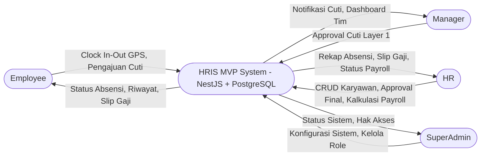
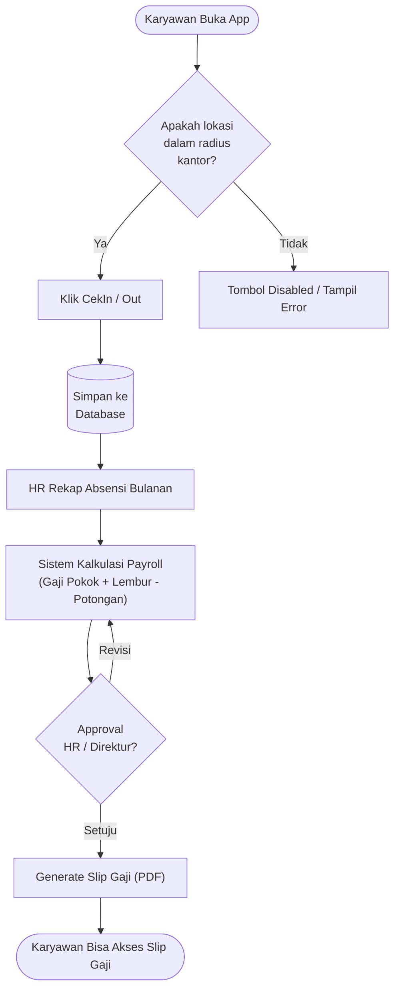

# HRIS (Human Resource Information System) Blueprint

## 1. Executive Summary
Dokumen ini mendefinisikan rancangan awal (blueprint) untuk pengembangan sistem HRIS internal perusahaan. Untuk tahap MVP (Minimum Viable Product), sistem akan difokuskan pada modul inti: **Manajemen Karyawan, Absensi, dan Payroll**.

## 2. Tech Stack & Architecture
Sistem akan dibangun menggunakan arsitektur modern fullstack:
- **Framework Utama:** NestJS
- **Styling:** Tailwind CSS + UI Library (shadcn/ui direkomendasikan)
- **Database:** PostgreSQL
- **ORM:** Prisma ORM
- **Authentication:** JWT (Passport / @nestjs/jwt)

## 3. Scope of Work (MVP)

### A. Employee Management (Manajemen Data Karyawan)
- CRUD Data Karyawan (Profil, Jabatan, Departemen).
- Manajemen kontrak kerja & status karyawan (Tetap, Kontrak, Probation).
- Struktur organisasi (Manager -> Subordinates).

### B. Attendance (Absensi)
- **Mekanisme Clock In/Out:** Berbasis koordinat GPS (Radius validasi dari lokasi kantor/site).
- Riwayat absensi harian karyawan.
- Pengajuan cuti, sakit, dan izin (Approval berjenjang: Manager -> HR).
- Rekapitulasi jam kerja dan keterlambatan.

### C. Payroll (Penggajian)
- **Kalkulasi Dinamis:** 
  - Komponen Pendapatan: Gaji Pokok, Tunjangan Tetap, Lembur (Overtime).
  - Komponen Potongan: Keterlambatan, Absen tanpa keterangan (Alpa), BPJS (Kesehatan & Ketenagakerjaan), PPh 21.
- Generate slip gaji digital (PDF).
- Approval payroll cycle sebelum pencairan.

## 4. Role & Authorization
Sistem di desain untuk *Single Company* dengan hierarki role sebagai berikut:
1. **SuperAdmin:** Akses penuh ke seluruh konfigurasi sistem, module, dan database.
2. **HR (Human Resource):** Mengelola master data karyawan, rekap absensi, approval cuti (final), dan kalkulasi payroll.
3. **Manager:** Melihat dashboard tim, approval cuti/izin bawahan (layer 1), dan evaluasi performa (jika ada).
4. **Employee (Karyawan):** Akses portal mandiri (Self-Service) untuk absensi (clock in/out), melihat slip gaji, dan pengajuan cuti/izin.

## 5. Database Schema (High-Level)
- `users`: Data autentikasi.
- `employees`: Profil detail karyawan (relasi 1-1 dengan `users`).
- `departments`: Divisi/Departemen.
- `positions`: Jabatan.
- `attendances`: Log absensi harian (termasuk latitude/longitude).
- `leave_requests`: Pengajuan cuti/izin.
- `payroll_records`: Rekapitulasi gaji per bulan per karyawan.
- `salaries`: Master gaji pokok dan komponen tunjangan per karyawan.

## 6. Fase Pengembangan Selanjutnya (Post-MVP)
Merujuk pada gambar visi sistem, fase berikutnya akan mencakup:
- Recruitment & Onboarding
- Performance Management (KPI & Appraisal)
- Career & Development (Training)
- HR Dashboard & Analytics yang komprehensif
- Manajemen Benefit (Claim Reimbursement)

## 7. Diagram & Alur Sistem

### A. Context Diagram
Diagram berikut menunjukkan interaksi antara pengguna (aktor) dengan Sistem HRIS.

### B. Flowchart Utama (Absensi & Penggajian)
Berikut adalah alur sederhana dari proses absensi harian hingga penggajian bulanan.

