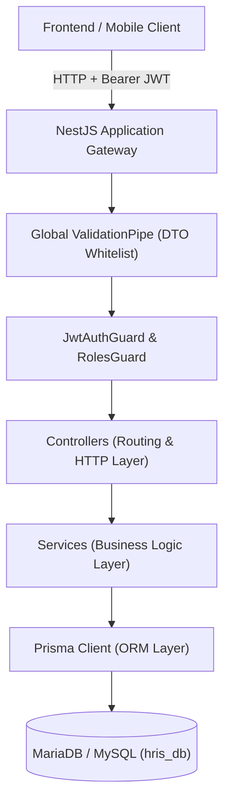
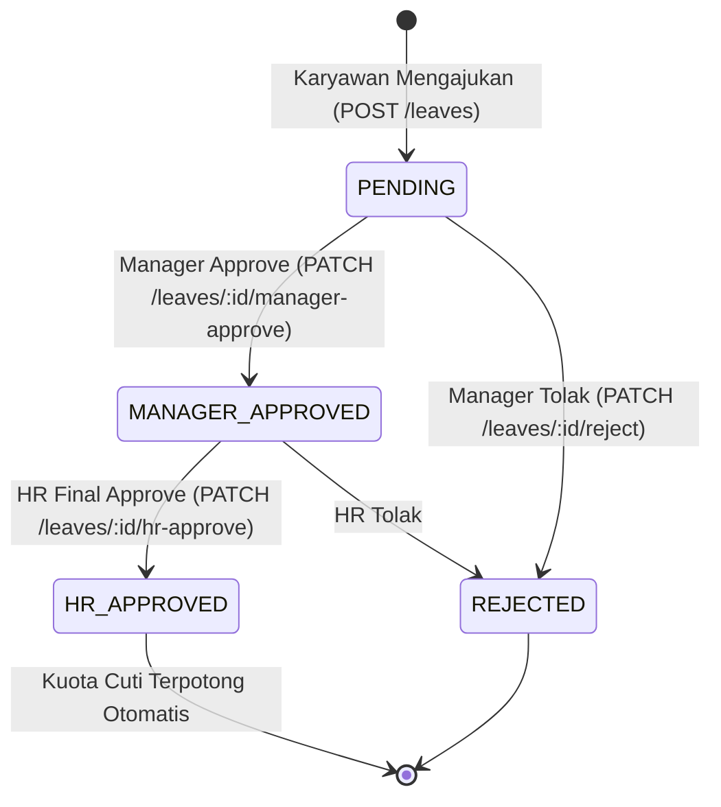

# Dokumentasi REST API & Penjelasan Kode HRIS
**Stack:** NestJS 12 | Prisma 6 | MariaDB / MySQL | JWT Authentication

---

## 1. Arsitektur & Prinsip Sistem

Backend HRIS ini dibangun dengan arsitektur modular NestJS dan database relasional MariaDB (melalui Prisma ORM).



### Konfigurasi Global
- **Base URL:** `http://localhost:3000`
- **Prefix Path:** Mengikuti nama modul (misal `/auth`, `/employees`, `/attendance`)
- **Global Pipes:** `ValidationPipe({ whitelist: true, transform: true })` — Menolak atribut di luar DTO dan otomatis mengonversi tipe data query/param.
- **CORS:** Aktif dengan `credentials: true`.
- **Database Engine:** MariaDB 10.11+ / MySQL 8.0+ via driver `mysql` di Prisma.

---

## 2. Otentikasi & Keamanan (Auth & RBAC)

Sistem menggunakan **JWT (JSON Web Token)** dan **Role-Based Access Control (RBAC)**.

### Hirarki Role Pengguna
| Role | Akses Utama |
| :--- | :--- |
| `SUPER_ADMIN` | Akses absolut seluruh modul, manajemen user, kantor, master departemen & gaji. |
| `HR` | Manajemen master karyawan, persetujuan akhir cuti, rekap absensi, generate & revisi payroll. |
| `MANAGER` | Melihat data bawahan langsung, persetujuan cuti tahap 1, monitoring absensi tim. |
| `EMPLOYEE` | Melakukan clock-in/out, pengajuan cuti pribadi, melihat profil & slip gaji sendiri. |

### Header Autentikasi
Untuk semua endpoint yang membutuhkan login, sertakan header:
```http
Authorization: Bearer <ACCESS_TOKEN>
```

---

## 3. Spesifikasi Lengkap Endpoint API

### 3.1. Modul Autentikasi (`/auth`)

#### 1. Register User Baru
* **Endpoint:** `POST /auth/register`
* **Auth:** Publik
* **Request Body:**
```json
{
  "name": "Budi Santoso",
  "email": "budi@kerabat.id",
  "password": "Password123"
}
```
* **Response (201 Created):**
```json
{
  "id": "a04b98e5-c309-4bbd-8872-766c94dd1275",
  "name": "Budi Santoso",
  "email": "budi@kerabat.id",
  "role": "EMPLOYEE"
}
```

#### 2. Login
* **Endpoint:** `POST /auth/login`
* **Auth:** Publik (Dilindungi `LoginRateLimitGuard` untuk mencegah brute force)
* **Request Body:**
```json
{
  "email": "admin@kerabat.id",
  "password": "admin12345"
}
```
* **Response (200 OK):**
```json
{
  "accessToken": "eyJhbGciOiJIUzI1NiIsInR5cCI6IkpXVCJ9...",
  "user": {
    "id": "fb2f6e26-d89d-4565-98ee-c567fc5b3f7c",
    "name": "Fatkur Rizky (Admin)",
    "email": "admin@kerabat.id",
    "role": "SUPER_ADMIN"
  }
}
```

#### 3. Cek Profil Akun Login
* **Endpoint:** `GET /auth/profile`
* **Auth:** Bearer Token

---

### 3.2. Modul Karyawan (`/employees`)

| Method | Endpoint | Hak Akses | Deskripsi |
| :--- | :--- | :--- | :--- |
| `GET` | `/employees` | `SUPER_ADMIN`, `HR`, `MANAGER` | Daftar karyawan (Filter: `departmentId`, `status`, `search`) |
| `GET` | `/employees/me` | Semua Role | Mendapatkan detail profil karyawan dari akun yang sedang login |
| `GET` | `/employees/:id` | `SUPER_ADMIN`, `HR`, `MANAGER` | Detail karyawan berdasarkan ID |
| `GET` | `/employees/:id/subordinates` | `SUPER_ADMIN`, `HR`, `MANAGER` | Daftar bawahan langsung (khusus manager) |
| `GET` | `/employees/:id/manager` | Semua Role | Menampilkan atasan langsung |
| `POST` | `/employees` | `SUPER_ADMIN`, `HR` | Membuat profil data karyawan baru |
| `PATCH` | `/employees/:id` | `SUPER_ADMIN`, `HR` | Update data profil karyawan |
| `PATCH` | `/employees/:id/status` | `SUPER_ADMIN`, `HR` | Ubah status kepegawaian (`TETAP`, `KONTRAK`, `PROBATION`) |
| `DELETE` | `/employees/:id` | `SUPER_ADMIN`, `HR` | Hapus data karyawan |

**Contoh Payload POST `/employees`:**
```json
{
  "userId": "a04b98e5-c309-4bbd-8872-766c94dd1275",
  "nik": "EMP-2026-004",
  "phone": "081234567890",
  "address": "Jl. Basuki Rahmat No. 12, Kediri",
  "departmentId": "dept-uuid",
  "positionId": "pos-uuid",
  "managerId": "manager-emp-uuid",
  "status": "TETAP",
  "leaveQuota": 12
}
```

---

### 3.3. Modul Absensi (`/attendance`)

#### 1. Clock In (Masuk Kerja)
* **Endpoint:** `POST /attendance/clock-in`
* **Auth:** Bearer Token
* **Request Body:**
```json
{
  "latitude": -7.8166,
  "longitude": 112.0114
}
```
* **Aturan Bisnis:** 
  - Wajib berada di dalam radius lokasi kantor aktif (`OfficeLocation.radius`).
  - Jika jam clock-in > 08:00 WIB, otomatis berstatus `LATE`.
  - Hanya bisa clock-in sekali per hari kerja.

#### 2. Clock Out (Pulang Kerja)
* **Endpoint:** `POST /attendance/clock-out`
* **Auth:** Bearer Token
* **Request Body:** (Sama dengan clock in, mengirimkan koordinat GPS)
* **Aturan Bisnis:** Menghitung menit lembur (`overtimeMinutes`) jika pulang setelah jam 17:00.

#### 3. Rekap & Riwayat Absensi
* `GET /attendance/my-records?month=10&year=2026` — Riwayat absensi diri sendiri.
* `GET /attendance/recap/my?month=10&year=2026` — Statistik total masuk, telat, alpha diri sendiri.
* `GET /attendance/team?date=2026-10-25` — Melihat kehadiran bawahan (Khusus Manager).
* `GET /attendance/recap?month=10&year=2026` — Rekap komprehensif seluruh karyawan untuk HR/Admin.

---

### 3.4. Modul Cuti & Perizinan (`/leaves`)



#### 1. Pengajuan Cuti (`POST /leaves`)
* **Request Body:**
```json
{
  "type": "CUTI",
  "startDate": "2026-11-02",
  "endDate": "2026-11-04",
  "reason": "Keperluan keluarga di luar kota"
}
```
* **Validasi Otomatis:**
  - Hanya menghitung hari kerja (Senin s/d Jumat). Sabtu dan Minggu tidak memotong kuota.
  - Jika tipe `CUTI`, sistem memvalidasi sisa `leaveQuota`. Jika tidak cukup, ditolak `400 Bad Request`.

#### 2. Antrean Approval (`GET /leaves/approvals`)
* Menampilkan daftar permohonan yang menunggu persetujuan berdasarkan role user yang login:
  - Role `MANAGER`: Melihat permohonan bawahan yang berstatus `PENDING`.
  - Role `HR` / `SUPER_ADMIN`: Melihat permohonan yang sudah berstatus `MANAGER_APPROVED`.

---

### 3.5. Modul Penggajian (`/payroll`)

#### 1. Generate Payroll Otomatis (`POST /payroll/generate`)
* **Hak Akses:** `HR`, `SUPER_ADMIN`
* **Request Body:**
```json
{
  "month": 10,
  "year": 2026
}
```
* **Output:** Otomatis menghitung dan membuat rekaman slip gaji untuk semua karyawan aktif.

#### 2. Alur Status Payroll
* `PATCH /payroll/:id/approve` $\rightarrow$ Status berubah dari `DRAFT` ke `APPROVED`.
* `PATCH /payroll/:id/revise` $\rightarrow$ Mengubah nominal komponen gaji secara manual dengan mencantumkan alasan revisi (`revisionNote`).
* `PATCH /payroll/:id/mark-paid` $\rightarrow$ Menandai slip gaji telah ditransfer/dibayarkan (`PAID`).

#### 3. Unduh Slip Gaji PDF (`GET /payroll/:id/payslip-pdf`)
* Mengembalikan *stream* file PDF biner (`Content-Type: application/pdf`) dengan *layout* slip gaji resmi lengkap dengan rincian tunjangan, potongan BPJS, PPh 21, dan denda keterlambatan.

---

### 3.6. Modul Master Data

* **Departemen (`/departments`)**: CRUD divisi perusahaan & visualisasi struktur organisasi tree (`GET /departments/:id/tree`).
* **Jabatan (`/positions`)**: CRUD jabatan pekerjaan serta nominal `baseSalary` standar per jabatan.
* **Gaji Karyawan (`/salaries`)**: Konfigurasi gaji pokok (`baseSalary`), tunjangan tetap (`allowance`), dan tarif lembur per jam (`overtimeRate`).
* **Lokasi Kantor (`/office-locations`)**: Pengaturan titik koordinat kantor (`latitude`, `longitude`) dan batas radius toleransi GPS dalam meter (`radius`).

---

## 4. Bedah Kode & Logika Bisnis Utama

### 4.1. Validasi Lokasi GPS dengan Haversine Formula
File: `src/attendance/attendance.service.ts`

Sistem menghitung jarak kelengkungan bumi antara koordinat ponsel karyawan dengan titik kantor menggunakan formula Haversine:

$$\Delta\sigma = 2 \arcsin \left( \sqrt{\sin^2\left(\frac{\Delta\phi}{2}\right) + \cos(\phi_1)\cos(\phi_2)\sin^2\left(\frac{\Delta\lambda}{2}\right)} \right)$$

```typescript
calculateHaversineDistance(lat1: number, lon1: number, lat2: number, lon2: number): number {
  const toRad = (deg: number) => (deg * Math.PI) / 180;
  const dLat = toRad(lat2 - lat1);
  const dLon = toRad(lon2 - lon1);

  const a =
    Math.sin(dLat / 2) * Math.sin(dLat / 2) +
    Math.cos(toRad(lat1)) * Math.cos(toRad(lat2)) *
    Math.sin(dLon / 2) * Math.sin(dLon / 2);

  const c = 2 * Math.atan2(Math.sqrt(a), Math.sqrt(1 - a));
  return 6371000 * c; // Hasil dalam satuan meter
}
```
Jika jarak yang didapat lebih besar dari `office.radius` (default: 50 meter), permintaan absensi otomatis dilempar sebagai `BadRequestException`.

---

### 4.2. Perhitungan Hari Kerja Bersih (Excluding Weekend)
File: `src/leave/leave.service.ts`

Saat karyawan mengajukan cuti (misal Jumat s/d Senin depan), sistem tidak menghitung 4 hari kalender, melainkan hanya 2 hari kerja:

```typescript
calculateWorkDays(start: Date, end: Date): number {
  let count = 0;
  const cursor = new Date(Date.UTC(start.getUTCFullYear(), start.getUTCMonth(), start.getUTCDate()));
  const last = new Date(Date.UTC(end.getUTCFullYear(), end.getUTCMonth(), end.getUTCDate()));

  while (cursor <= last) {
    const dayOfWeek = cursor.getUTCDay();
    // 0 = Minggu, 6 = Sabtu (dilewati)
    if (dayOfWeek !== 0 && dayOfWeek !== 6) {
      count++;
    }
    cursor.setUTCDate(cursor.getUTCDate() + 1);
  }
  return count;
}
```

---

### 4.3. Formula Matematis Penggajian (Payroll Engine)
File: `src/payroll/payroll.service.ts`

Perhitungan gaji bulanan mengintegrasikan data absensi dan aturan ketenagakerjaan:

1. **Uang Lembur:**
   $$\text{Tarif Lembur/Jam} = \text{overtimeRate} \lor \text{round}\left(\frac{\text{Gaji Pokok}}{173}\right)$$
   $$\text{Total Lembur} = \left\lfloor\frac{\text{Total Menit Lembur}}{60}\right\rfloor \times \text{Tarif Lembur/Jam}$$

2. **Denda & Potongan Absensi:**
   - Telat: $\text{Jumlah Telat} \times \text{Rp } 50.000$
   - Mangkir (Alpha): $\text{Jumlah Alpha} \times \text{round}\left(\frac{\text{Gaji Pokok}}{22}\right)$

3. **BPJS Ketenagakerjaan & Kesehatan (Porsi Karyawan):**
   $$\text{BPJS} = (\text{Gaji Pokok} + \text{Tunjangan}) \times 3\%$$

4. **PPh Pasal 21 Bulanan:**
   $$\text{Penghasilan Kena Pajak (PKP Bulanan)} = \max(0, \text{Penghasilan Bruto} - 4.500.000)$$
   $$\text{PPh 21} = \text{PKP Bulanan} \times 5\%$$

5. **Gaji Bersih Diterima (Take Home Pay):**
   $$\text{Total} = \text{Bruto} - (\text{Potongan Absensi} + \text{BPJS} + \text{PPh21})$$
